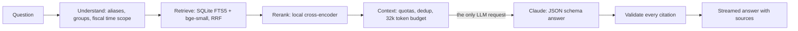

# Keel

Keel answers business questions about SEC 10-K and 10-Q filings, such as
"What are the primary risk factors facing Apple, Tesla, and JPMorgan, and
how do they compare?", with **exactly 1 LLM request per question**.
Question understanding, hybrid retrieval, and reranking are deterministic
code and small local models; one Claude call writes a structured answer
from the retrieved filing text; and a validator checks every citation
against that text before the page shows it. Every number carries its
fiscal period, every claim links to the passage on sec.gov, and anything
the filings cannot support is listed as a gap instead of guessed.

**Live:** <https://keeldd.com>. Bring your own Anthropic API key to ask
anything; the example questions answer from the cache without one.

## How it works



- **No LLM outside the answer call.** Not at index time, not in retrieval
  or reranking, not after the answer. The mock provider counts requests,
  and `test_single_request` guards the rule in CI. Retries happen only
  before any content arrives, so a question never produces 2 answers.
- **Fiscal periods from the cover page.** NVIDIA's fiscal 2025 ended
  January 26, 2025; the parser reads that from the filing, not the file
  name, and the answer says so.
- **Citations are checked, not trusted.** A citation to anything outside
  the retrieved context is removed, and a finding left without one is
  marked `unverified` on the page, never hidden.

The full design is in [docs/ARCHITECTURE.md](docs/ARCHITECTURE.md).

## Key numbers

| Measure | Value |
| --- | --- |
| Corpus | 246 filings (78 MB), 54 tickers; 245 indexed, 1 quarantined for a metadata conflict |
| Index | 63,688 chunks (22,163 tables), 384-dim vectors, built locally at $0 |
| Retrieval recall at 25 | 0.86 hybrid (0.79 lexical only, 0.82 dense only, 0.81 without reranker); MRR 0.96 |
| Faithfulness (LLM judge) | 0.94; citation precision 1.00 |
| Numeric accuracy | 9 of 9 gold values within 0.5% |
| Refusals | 4 of 4 out-of-scope questions refused with 0 model requests |
| Latency, full answer | p50 23.2 s, p95 34.2 s (first prose within seconds) |
| Cost per answer | 0.091 USD mean |

From eval run `eval-20261028T012734Z` (prompt 1.5.1, index 1.2.0), which
passes all 10 regression gates.

## Features

- **Streaming answers**: direct answer, findings per company with
  citation chips, comparison table, coverage chips, confidence, gaps, and
  follow-up questions.
- **Filing reader**: a citation opens the cited section from Keel's own
  index with the quote highlighted, plus a deep link that jumps to the
  excerpt on sec.gov.
- **Trace drawer**: the audit record of each answer, with
  `model requests: 1`, tokens, cost, and latency per stage.
- **Exact reported numbers** from SEC XBRL company facts for 8 concepts,
  cited by fact ID.
- **Any company on demand**: `keel add TICKER` fetches the latest 10-K and
  10-Q from EDGAR; a watch list refreshes nightly; an admin browser lists
  active filers by SEC industry.
- **Financials page**: income statement, balance sheet, and cash flow
  charts from XBRL, annual or quarterly.
- **Work product**: history, shareable links, saved comp sets
  (`my software comps`), question templates, feedback, and memo export to
  Markdown or DOCX with numbered footnotes.
- **Operations**: named users and roles, admin jobs with live step logs,
  answer cache and offline mode, fallback model and circuit breaker,
  daily budget, backups and restore.
- **Eval page**: the regression gates as charts, and each prompt version's
  rule changes side by side.

## Tech stack

| Layer | Tools |
| --- | --- |
| Backend | Python 3.12, FastAPI, uvicorn, pydantic, SQLite FTS5, NumPy, `uv` |
| Models | Claude Sonnet 5.5 (answers), Claude Haiku 5.5 (fallback), Claude Opus 5.5 (eval judge only); `BAAI/bge-small-en-v1.5` embeddings and `cross-encoder/ms-marco-MiniLM-L6-v2`, both pinned and run locally |
| Front-end | React 19, strict TypeScript, Vite, Tailwind CSS 4, Motion, `marked` + DOMPurify |
| Tests | pytest, mypy `--strict`, ruff, pylint, Vitest, React Testing Library, Playwright |
| Infrastructure | Docker, Railway, AWS EC2, Caddy, CloudFront, Route 53, ACM, S3, SSM, Terraform, GitHub Actions with OIDC, release-please |

## Try the live site

Open <https://keeldd.com> and click an example question, or paste your
Anthropic key to ask your own. The key goes with each request in the
`X-Anthropic-Api-Key` header and is never stored or logged; the cost is
billed to your account. The same request with curl:

```bash
curl -N -X POST https://www.keeldd.com/api/ask \
  -H "X-Anthropic-Api-Key: $ANTHROPIC_API_KEY" \
  -H "Content-Type: application/json" \
  -H "Accept: text/event-stream" \
  -d '{"question": "How has NVIDIA'"'"'s revenue and growth outlook changed over the last two years?"}'
```

## Run it locally

Requirements: Python 3.12, [`uv`](https://docs.astral.sh/uv/), Node 22,
and the corpus zip at `corpus/edgar_corpus.zip` (or set
`KEEL_CORPUS__URL` and run `uv run keel bootstrap` to download it).

```bash
cp .env.example .env                   # set ANTHROPIC_API_KEY and KEEL_API_TOKEN
uv sync --all-extras
uv run keel doctor --download-models   # checks FTS5, keys, ports; fetches the 2 pinned models
uv run keel index                      # parse, chunk, embed; --incremental skips unchanged files
uv run keel serve                      # API and front-end on http://localhost:8000
```

`KEEL_API_TOKEN` is any string you choose; paste the same value into the
page's access token field. The full index build is CPU-bound (1 h 44 min
on an 8-thread laptop, mostly embeddings). `make demo` runs the same
steps, and `docker compose up` runs them in a container.

For front-end work, run the Vite dev server, which proxies `/api` to port
8000:

```bash
npm run dev --prefix web               # http://localhost:5173
```

Other commands:

```bash
uv run keel ask "question"             # one answer in the terminal; --json for the record
uv run keel retrieve --question 1 --summary
uv run keel eval                       # retrieval metrics; --answers adds live answers and the judge
uv run keel add ZTS                    # ingest a company from EDGAR
make test                              # ruff, mypy, pylint, pytest with coverage
npm run check --prefix web             # gts lint, tsc, Vitest, Vite build
npm run test:e2e --prefix web          # Playwright against keel serve with the mock provider
```

Tests never touch the network: the mock provider stands in for the model
(`KEEL_LLM__PROVIDER=mock`), and the pinned models load from the local
Hugging Face cache.

## Evaluation

28 golden questions cover single-company, comparison, trend, numeric,
sector, out-of-corpus, ambiguous-entity, and adversarial cases. Retrieval
is scored against labeled chunks; answers are scored by an LLM judge
(a different model from the answer model) that reads each claim with the
exact text it cites, plus code checks for numbers, schema, refusals, and
coverage. Every prompt version was measured before it shipped, and one
that failed an adversarial check was rejected.

- [docs/EVALUATION.md](docs/EVALUATION.md): method and findings.
- [eval/report.md](eval/report.md): the last full run, per question.
- [docs/PROMPT_LOG.md](docs/PROMPT_LOG.md): every prompt version, its
  hypothesis, and its measured result.

## Project layout

| Path | Contents |
| --- | --- |
| `keel/` | The Python package: parser, sections, chunker, indexer, understanding, retriever, context, prompt, providers, citations, EDGAR, export, CLI |
| `keel/api/` | FastAPI app, routes, SSE, auth, rate limits, admin and debug routes |
| `keel/evaluation/` | Golden set runner, metrics, judge, regression gates |
| `web/` | React front-end; `web/e2e/` holds the Playwright specs |
| `config/` | `keel.yaml`, company aliases, sector groups, synonyms, XBRL concept maps, prices |
| `prompts/` | Versioned system prompt, user template, and answer schema |
| `eval/` | Golden questions, chunk labels, and the latest report |
| `tests/` | `unit/` (snippets, pure functions), `integration/` (mini corpus, API with the mock provider), `eval/` (full index) |
| `infra/` | Railway and AWS host guides, Terraform for AWS, Caddyfile, systemd timers, deploy and backup scripts |
| `docs/` | Design and reference documents |

## Documentation

| Document | What it covers |
| --- | --- |
| [ARCHITECTURE.md](docs/ARCHITECTURE.md) | The design end to end, with measured numbers |
| [DECISIONS.md](docs/DECISIONS.md) | 40 design decisions and 15 assumptions |
| [SECURITY.md](docs/SECURITY.md) | Threat model and controls S-01 to S-20 |
| [EDGE_CASES.md](docs/EDGE_CASES.md) | 75 edge cases with behaviour and tests |
| [EVALUATION.md](docs/EVALUATION.md) | How quality was measured |
| [PROMPT_LOG.md](docs/PROMPT_LOG.md) | Prompt versions and their results |
| [API_ADMIN.md](docs/API_ADMIN.md) | Admin, watch list, and debug API |
| [infra/README.md](infra/README.md) | Deployment, custom domain, backups, restore |
| [CONTRIBUTING.md](CONTRIBUTING.md) | Branching, commits, code standards |

## License

[MIT](LICENSE). SEC EDGAR filings are public domain works of the United
States government.
