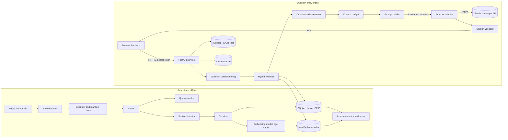

# Keel

Grounded answers to business questions about SEC filings, from 1 LLM call.

## What Keel does

- Answers business questions about the SEC 10-K and 10-Q filings of 54 companies, plus any company that `keel add` fetches from EDGAR.
- Grounds every claim in filing text: each finding cites a chunk of a filing, and the server checks every citation against the context after the call.
- Marks a finding with no valid citation `unverified`; the page never hides it.
- Labels every number with its fiscal period and period end date, and always shows the coverage statement and the gaps list.
- Writes 1 audit record per question (request ID, user, chunk IDs, prompt hash, model, tokens, cost, latency), so any answer can be traced and rebuilt.

## The single-call constraint and how Keel obeys it

Decision D-01: each question makes exactly 1 model request (D-04 allows a retry only after a request fails before any content). Everything before the call is deterministic code with no LLM in it (D-02, D-28):

1. Input checks: length, language, empty question (chapter 10.7).
2. Question understanding: companies from aliases and tickers, groups, comp sets, the fiscal-aware time scope, the question type, and the out-of-scope parts (chapter 10).
3. Retrieval per company or period cell: SQLite FTS5 (BM25) and a dense bge-small index under the same metadata filter, fused with reciprocal rank fusion (chapter 11).
4. Reranking with a pinned cross-encoder (a local model, not an LLM), then the near-duplicate collapse by SimHash.
5. The context budget: per-company quotas under 32,000 tokens and 48 chunks (chapter 11.6).
6. For a numeric question, the XBRL company facts lines from the SEC cache (chapter 26.1).
7. The prompt: the system block, the question analysis, the context index, and the chunks as untrusted data (chapter 12).

Then 1 streamed request to Claude Sonnet 5.5 with structured output. After the call there is no model either: the citation validator, the answer cache write, and the audit record are code. A question that is out of scope gets its answer with 0 model requests. The mock provider counts the requests, and `test_single_request` guards the rule in CI.

## Quick start

1. `cp .env.example .env` and set `ANTHROPIC_API_KEY` and `KEEL_API_TOKEN`.
2. `make demo` (builds the front-end and, on the first run, the index; the full build took 1 h 44 min on the Intel laptop of the build, the embedding step at 10.6 chunks per second; chapter 9.6 estimates about 27 minutes on a faster CPU).
3. Open `http://localhost:8000` and paste the value of `KEEL_API_TOKEN` into **Access token**.

Alternative: `docker compose up` (the image builds the front-end in a Node stage; 1.5 GB).

The first run needs the corpus zip at `corpus/edgar_corpus.zip` and the 2 pinned models in the Hugging Face cache (`uv run keel doctor --download-models`). `uv run keel doctor` checks FTS5, the models, the keys, the clock, and the port.

## Example request

```bash
# Streamed (server-sent events)
curl -N -X POST http://localhost:8000/api/ask \
  -H "Authorization: Bearer $KEEL_API_TOKEN" \
  -H "Content-Type: application/json" \
  -H "Accept: text/event-stream" \
  -d '{"question": "What are the primary risk factors facing Apple, Tesla, and JPMorgan, and how do they compare?"}'

# Non-streamed JSON
curl -s -X POST http://localhost:8000/api/ask \
  -H "Authorization: Bearer $KEEL_API_TOKEN" \
  -H "Content-Type: application/json" \
  -d '{"question": "How has NVIDIA'"'"'s revenue and growth outlook changed over the last two years?", "options": {"stream": false}}' | jq .answer.direct_answer
```

The stream sends `meta`, `analysis`, `retrieval`, `answer_delta`, `findings`, `final` (with the audit record), and `done` (chapter 14.3). From the terminal: `uv run keel ask "question"`, or `--json` for the full record.

## The 3 example questions and what to look at in each answer

| Question | What to look at |
| --- | --- |
| 1. What are the primary risk factors facing Apple, Tesla, and JPMorgan, and how do they compare? | The alias resolution (JPMorgan to JPM), the 3 per-company quotas and the collapse count in the retrieval panel, the comparison table, and the gaps list: JPM has 4 filings in the corpus. The trace drawer shows `model requests: 1`. Measured: 15 to 18 valid citations, 0 drift, $0.10 to $0.12 |
| 2. How has NVIDIA's revenue and growth outlook changed over the last two years? | The fiscal year that ends in January: every number carries its label ("Q3 fiscal 2026 (ended October 26, 2025)"). The NVDA 10-K filed in February 2026 is not in the corpus (A-15 false), so the window ends with the fiscal 2026 Q3 10-Q. Measured: 10 to 11 valid citations, $0.09 to $0.10 |
| 3. What regulatory risks do the major pharmaceutical companies face, and how are they addressing them? | The `pharma` group (PFE, JNJ, MRK, LLY, ABBV), the response share of the context (Item 1 and MD&A next to the risk factors), and the gaps: MRK, LLY, and ABBV have 1 10-K each. Measured: 14 to 19 valid citations, $0.11 to $0.14 |

## Corpus facts and known limits

- 246 filings of 54 companies (89 10-Ks, 157 10-Qs), filed 2022-02-09 to 2026-02-19, plus 1 GE file from 2015. 245 indexed, 1 quarantined: `GE_10K_2015-02-27_full.txt` (`registrant_mismatch`, the cover names General Electric Capital Corporation; D-20).
- 64,727 chunks (22,677 of them tables); `chunks.sqlite` 164 MB and `vectors.npy` 99 MB. The chapter 9.1 estimate was 35,000 to 40,000; every table is its own chunk.
- 12 companies have full quarterly coverage for 2023 to 2025, not the 15 the manifest description claims (E-D-25). 17 companies have any 10-Q.
- The latest NVDA 10-K is fiscal 2025 (filed 2025-02-26); the February 2026 10-K is absent (A-15).
- 1 of 88 10-Ks (IBM 2025) lacks the core sections in the file: its MD&A and risk factors sit in an exhibit.
- Retrieval recall at 25 is 0.86 against a gate of 0.85, and faithfulness 0.895 against 0.90 (see Evaluation).
- `keel add` extends the index with the latest 10-K and 10-Q of any company; ZTS and WDAY were added on a scratch copy of the index (stage 14), not on the published index.

## Architecture



The zip goes through a safe extractor; the inventory compares the files with the manifest. The parser reads each file, takes the fiscal period from the cover page (never the file name, D-21), and quarantines a metadata conflict. The section detector marks the canonical items, and the chunker cuts them into chunks of about 400 tokens with deterministic IDs (D-23). The chunks and the FTS5 index live in 1 SQLite file, the vectors in 1 NumPy file, and the manifest holds the checksums of both. At question time the FastAPI service resolves the question, retrieves and reranks per company, fills the budget, builds the prompt, sends 1 streamed request, validates the citations, streams the answer to the React front-end, and writes 1 audit record and 1 answer cache entry.

## Configuration

`config/keel.yaml` holds every setting; secrets come only from the environment (`ANTHROPIC_API_KEY`, `KEEL_API_TOKEN`). A top-level key overrides as `KEEL_<KEY>` (`KEEL_OFFLINE=1`), a nested key as `KEEL_<SECTION>__<KEY>` (`KEEL_INDEX__DIR=/data/index`). The sections:

| Section | Holds |
| --- | --- |
| `server`, `cache` | host, port, the front-end build, the answer cache directory |
| `corpus`, `index`, `logs` | the zip, the extracted corpus and manifest, the index directory, the audit, export, and refresh logs |
| `parser`, `dictionaries`, `chunker` | the parser version and word lists, the companies, groups, synonyms, the chunk sizes |
| `embedding`, `reranker` | the 2 pinned Hugging Face models with their revision hashes |
| `retrieval` | the candidate counts, the fusion, the context budget, the calibration factor 1.91 |
| `llm` | `claude-sonnet-5-5`, the fallback `claude-haiku-5-5`, the judge `claude-opus-5-5`, the prompt version 1.4.0, the output mode, the retries |
| `limits`, `auth`, `pilot` | the rate limits and the daily budget, the users file, the comp set and feedback store, the templates |
| `edgar`, `demo`, `scheduler`, `deploy` | the SEC user agent and cache, the example questions and the 2 `keel add` tickers, the nightly refresh and backup, the host |

Prices live in `config/prices.yaml`, keyed by model id and checked on 2026-10-21.

## Commands

| Command | Does |
| --- | --- |
| `keel inventory` | extract the zip when needed, count it, check the manifest |
| `keel parse --all --summary` | parse every filing: header, XBRL cut, cover page, checks, quarantine |
| `keel chunk --all --summary` | detect the sections and cut the chunks |
| `keel index` | build the chunk store, FTS5, vectors, and manifest; `--incremental` reuses unchanged filings |
| `keel understand "question"` | resolve a question without a model call |
| `keel retrieve --question 1 --summary` | retrieve the context of a question, no model call |
| `keel ask "question"` | answer with 1 model request; `--json` for the record |
| `keel eval` | run the golden set and write `eval/report.md` |
| `keel serve` | the API and the front-end on port 8000 |
| `keel warm-cache` | fill the answer cache for the demo questions and pre-fetch the company facts |
| `keel doctor` | check FTS5, the models, the keys, the clock, the port; `--download-models` |
| `keel add TICKER` | add the latest 10-K and 10-Q of 1 company from EDGAR |
| `keel refresh` | add the new filings of the watched and added tickers; `--dry-run` |
| `keel export REQUEST_ID` | write a stored answer as a memo and 1 line of `<logs.dir>/exports.jsonl`; `--format markdown\|docx` |
| `keel bootstrap` | download the corpus and restore or build the index when absent; `keel backup` and `keel restore` |

Also: `keel calibrate` (the token calibration factor, 1 count call), `keel facts TICKER` (the company facts lines), `keel users`, `keel compsets`, `keel feedback`, `keel template`, `keel watch` (the pilot features of chapter 27), `make test`, and `npm run check --prefix web`.

## Evaluation

`uv run keel eval` runs the 28 questions of `eval/golden.yaml` against the index and writes `eval/report.md` and `eval/report.json` with recall at 10, 25, and 48, MRR, nDCG, the ablations (lexical, dense, hybrid, with and without the reranker), and the 10 gates of chapter 18.8. `--answers` adds the live answers and the judge (`claude-opus-5-5`), about 4 USD a run; `--gate` exits non-zero on a failed gate. CI runs the `ci` subset with answers on the mini corpus.

The last full run (`eval-20261022T123820Z`, index 1.2.0, prompt 1.4.0, judge prompt 1.2.0):

| Gate | Threshold | Value | Status |
| --- | --- | --- | --- |
| Recall at 25 | >= 0.85 | 0.86 | pass |
| MRR | >= 0.60 | 0.96 | pass |
| Faithfulness | >= 0.90 | 0.895 | fail |
| Citation precision | >= 0.90 | 0.99 | pass |
| Numeric accuracy | >= 0.90 | 1.00 (9 of 9) | pass |
| Schema validity | 1.00 | 1.00 | pass |
| Refusal correctness | 1.00 | 1.00 | pass |
| Latency p95 | <= 40 s | 31.3 s (p50 23.5 s) | pass |
| Mean cost per question | <= 0.25 USD | 0.0924 USD | pass |

1 model request per answer (24 for 24). [`docs/PERFORMANCE_MEMO.md`](docs/PERFORMANCE_MEMO.md) explains each number. The 1 failing gate is known: faithfulness is 0.895, short by 0.005. Trend answers (0.82) say what changed but cite only the later filing; prompt 1.5.0 makes a change claim cite both filings.

## Prompt log

[`docs/PROMPT_LOG.md`](docs/PROMPT_LOG.md): every prompt version from 1.0.0 to 1.4.0 with 1 hypothesis each, the measured before and after on the 3 example questions, and the request IDs. The shipped version is 1.4.0 (structured output, the company facts rule).

## Offline demo mode

`KEEL_OFFLINE=1` serves every question from the answer cache (`demo/answer_cache/`) with 0 model requests; a question outside the cache gets the degraded mode with the retrieved chunks. The cache key (D-29) holds the question, the index version, the prompt version, and the model, so a cached answer comes from the same pipeline on the same index. `keel warm-cache` fills the cache for the 28 golden questions (24 answers and 4 refusals, 2.17 USD on the first run, 0 requests on a second run) and pre-fetches the company facts of 56 tickers. The offline drill of stage 11 answered the 3 examples from the cache in 0.01 to 0.09 s with the provider unreachable.

The fallbacks of chapter 16.12, step 4: `demo/static/` holds the 3 example answers as static HTML (no script, the CSS inlined, only `www.sec.gov` links; open `demo/static/index.html` with the network off). `npm run static-export --prefix web -- URL` writes them again from a running `KEEL_OFFLINE=1 keel serve` with `KEEL_API_TOKEN` set, and `-- URL --record demo/recording.webm` records a draft video of the 3 questions (gitignored; the engineer saves the final recording as `demo/recording.mp4`).

## Security notes

The timebox controls (chapter 15) in the code:

- S-01 secrets from the environment only, a redacting log formatter, gitleaks in pre-commit.
- S-02 the filing text and the question wrapped as untrusted data, with a tag guard; the citation validator; server-attached SEC links only.
- S-03 DOMPurify with an allow list for the answer markdown, every other text as JSX text nodes, a CSP with `script-src 'self'`.
- S-04 input limits (length, body size, context caps); S-05 rate limits per user and a daily budget stop.
- S-06 bearer tokens compared in constant time; per-user tokens stored as sha256 hashes (chapter 27.2).
- S-07 the audit log, owner-only, rotated daily, never the prompt or a key; S-08 `uv.lock`, pinned model revisions, `pip-audit`; S-10 the safe zip extractor; S-11 outbound requests to `www.sec.gov` and `data.sec.gov` only for EDGAR.

The production list that the code does not hold yet: OpenID Connect instead of tokens, per-tenant isolation, private data rooms, the post-connect peer check of S-11 (on the stage 21 branch), read-only mounts and dropped capabilities for the container, and the audit log retention job. Chapter 15 lists each.

## Docs map

| Chapter | File |
| --- | --- |
| Front matter | [`docs/00_front_matter.md`](docs/00_front_matter.md) |
| 1 | [`docs/01_reader_map_and_executive_summary.md`](docs/01_reader_map_and_executive_summary.md) |
| 2 | [`docs/02_business_context_and_value_creation_for_a_pe_firm.md`](docs/02_business_context_and_value_creation_for_a_pe_firm.md) |
| 3 | [`docs/03_requirements.md`](docs/03_requirements.md) |
| 4 | [`docs/04_assumptions_and_decisions_log.md`](docs/04_assumptions_and_decisions_log.md) |
| 5 | [`docs/05_questions_for_the_panel.md`](docs/05_questions_for_the_panel.md) |
| 6 | [`docs/06_architecture.md`](docs/06_architecture.md) |
| 7 | [`docs/07_ingestion_and_normalization.md`](docs/07_ingestion_and_normalization.md) |
| 8 | [`docs/08_section_detection.md`](docs/08_section_detection.md) |
| 9 | [`docs/09_chunking_and_indexing.md`](docs/09_chunking_and_indexing.md) |
| 10 | [`docs/10_question_understanding_without_an_llm_call.md`](docs/10_question_understanding_without_an_llm_call.md) |
| 11 | [`docs/11_retrieval.md`](docs/11_retrieval.md) |
| 12 | [`docs/12_prompt_design_and_the_single_call.md`](docs/12_prompt_design_and_the_single_call.md) |
| 13 | [`docs/13_prompt_iteration_log.md`](docs/13_prompt_iteration_log.md) |
| 14 | [`docs/14_api_and_front_end.md`](docs/14_api_and_front_end.md) |
| 15 | [`docs/15_security.md`](docs/15_security.md) |
| 16 | [`docs/16_reliability_and_operations.md`](docs/16_reliability_and_operations.md) |
| 17 | [`docs/17_extensibility_and_maintainability.md`](docs/17_extensibility_and_maintainability.md) |
| 18 | [`docs/18_evaluation.md`](docs/18_evaluation.md) |
| 19 | [`docs/19_edge_case_register.md`](docs/19_edge_case_register.md) |
| 20 | [`docs/20_four_hour_build_plan.md`](docs/20_four_hour_build_plan.md) |
| 21 | [`docs/21_demo_runbook.md`](docs/21_demo_runbook.md) |
| 22 | [`docs/22_future_state_roadmap.md`](docs/22_future_state_roadmap.md) |
| 23 | [`docs/23_readme_outline_and_repo_hand_off_checklist.md`](docs/23_readme_outline_and_repo_hand_off_checklist.md) |
| 24 | [`docs/24_project_dictionary_and_conformance_note.md`](docs/24_project_dictionary_and_conformance_note.md) |
| 25 | [`docs/25_demo_additions_from_the_recruiter_guidance.md`](docs/25_demo_additions_from_the_recruiter_guidance.md) |
| 26 | [`docs/26_any_company_on_demand_the_edgar_extension.md`](docs/26_any_company_on_demand_the_edgar_extension.md) |
| 27 | [`docs/27_pilot_ready_product_features.md`](docs/27_pilot_ready_product_features.md) |
| 28 | [`docs/28_build_sequence.md`](docs/28_build_sequence.md) |
| 29 | [`docs/29_engineering_standards.md`](docs/29_engineering_standards.md) |

The build: [`docs/BUILD_REPORT.md`](docs/BUILD_REPORT.md) (every stage with its measured numbers and deviations), [`docs/STAGES.yaml`](docs/STAGES.yaml), [`docs/GOTCHAS.md`](docs/GOTCHAS.md). The demo and the pilot: [`docs/REHEARSAL.md`](docs/REHEARSAL.md) (the demo rehearsal and the pilot walk-through), [`docs/START_GUIDE.md`](docs/START_GUIDE.md) (the 1-page guide for the pilot users), and `scripts/pilot_metrics.py` (the weekly pilot numbers).

## Decisions and assumptions

[`docs/04_assumptions_and_decisions_log.md`](docs/04_assumptions_and_decisions_log.md): decisions D-01 to D-37 and assumptions A-01 to A-15, with the notes where the data overruled the plan (A-09, A-15, D-10, D-11, D-13). The decisions the build took without review are listed at the end of `docs/BUILD_REPORT.md`.

## Questions for the panel

[`docs/05_questions_for_the_panel.md`](docs/05_questions_for_the_panel.md).

## License and data source

The filings are SEC EDGAR documents. The corpus manifest's `license` key reads "Public domain (SEC filings are US government documents)" (assumption A-05). `keel add` and the company facts fetch from `www.sec.gov` and `data.sec.gov` with the user agent the SEC requires (`edgar.user_agent`) and at most 5 requests per second. The pinned models are `BAAI/bge-small-en-v1.5` and `cross-encoder/ms-marco-MiniLM-L6-v2` from Hugging Face, under their own licenses.
