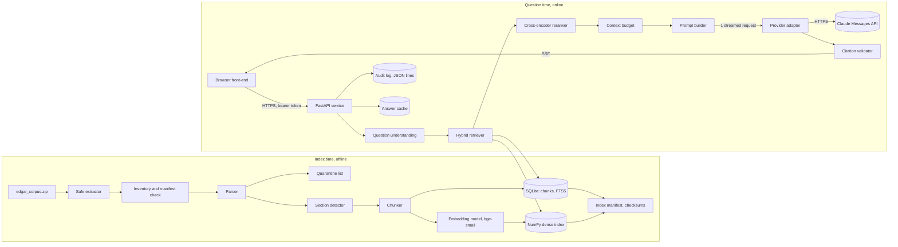

## 6. Architecture

Keel has 2 pipelines: an offline indexing pipeline that runs before the demo, and an online question pipeline that runs 1 model request per question. Both pipelines share 1 SQLite file, 1 NumPy file, and 1 manifest. This chapter gives the component diagram, the data flows, the trust boundaries, and the contract of each module.

### 6.1 Component diagram

In text: the zip file goes through a safe extractor into a corpus directory. The inventory step compares the directory with the manifest. The parser reads each file, validates the metadata against the cover page, and sends conflicts to the quarantine list. The section detector marks the canonical sections. The chunker splits each section into chunks with metadata. The lexical index and the chunk table live in 1 SQLite file. The embedding model writes 1 vector per chunk into a NumPy file. The manifest records checksums and versions for both.

At question time, the browser sends the question with a bearer token to the FastAPI service. Question understanding resolves entities, time scope, and question type. The hybrid retriever queries the lexical index and the dense index with metadata filters, and fuses the 2 result lists. The reranker rescores the top candidates. The context budget selects chunks under the token limit and under the quotas. The prompt builder assembles the system block, the question analysis, and the context. The provider adapter sends 1 streamed request. The citation validator checks each citation against the context and streams the answer to the browser. The service writes 1 audit record and 1 answer cache entry per question.

### 6.2 Data flow at index time

1. Extract the zip file with path checks (chapter 15).
2. Read `manifest.json` and compare the file list with the directory.
3. For each file, parse the header, remove the XBRL block, normalize the text, and read the cover page.
4. Validate the ticker, the company name, the form, and the dates. Quarantine a file with a conflict.
5. Detect the sections and map each section to the canonical taxonomy.
6. Reconstruct the tables with carried column labels and units.
7. Split each section into chunks, and compute the chunk ID, the chunk hash, and the SimHash.
8. Write the chunks and the metadata into SQLite, and build the FTS5 index.
9. Embed each chunk and write the vectors into the NumPy file.
10. Write the manifest with the corpus checksum, the index version, the model names, and the counts.
11. Replace the `index/current` directory with the new directory in 1 atomic rename.

### 6.3 Data flow at question time

1. Validate the request: length, language, token, and rate limit.
2. Return the cached answer if the answer cache has the key and the request permits the cache.
3. Run question understanding: entities, groups, time scope, question type, and flags.
4. If the question is out of scope, return an out-of-scope answer without a model request.
5. Build the metadata filters and the retrieval plan from the analysis.
6. Run the lexical query and the dense query, and fuse the results.
7. Rerank the top 80 candidates with the cross-encoder.
8. Collapse near-duplicates, apply the quotas, and fill the context budget.
9. Build the prompt, compute the prompt hash, and start the audit record.
10. Send 1 streamed request to the provider, and forward the answer events to the browser.
11. Validate the citations, attach the coverage data, and send the final JSON event.
12. Complete the audit record with the latency, the token counts, and the cost.

### 6.4 Trust boundaries

| Zone | Trust level | What crosses the boundary | Control |
| --- | --- | --- | --- |
| Browser | Untrusted | Questions, the bearer token | Input limits, token check, rate limit, output escape (chapter 15) |
| Service process | Trusted | Config, secrets from environment variables | Secrets never logged, never returned |
| Corpus text | Untrusted data | Filing text inside the prompt | Declared as data in the prompt, never rendered as HTML |
| Provider | External, contractual | The prompt, the answer | Timeouts, retries, schema validation, pinned model version |
| Disk (index, logs, cache) | Trusted | Index files, audit records | Checksums, file permissions, no secrets in logs |

### 6.5 Module contracts

| Module | Input | Output | Errors |
| --- | --- | --- | --- |
| `extractor` | Zip path, target directory | Extracted files, count | `UnsafePathError`, `BadZipError` |
| `inventory` | Corpus directory, manifest | Inventory report with counts and discrepancies | `ManifestMissing` (warning only) |
| `parser` | File path | `ParsedFiling` with metadata, clean text, tables, and a quarantine reason when a check fails | `HeaderError`, `SeparatorMissing`, `CoverPageNotFound`. Each error sends the file to the quarantine list. |
| `sections` | Clean text, form | List of `Section` with canonical name, start, end, item label, and confidence | None. A failure gives `unknown` spans and a warning. |
| `chunker` | Sections, tables, metadata | List of `Chunk` with ID, text, token estimate, metadata, SimHash | None. The chunker splits a long table row at a cell boundary. |
| `indexer` | Chunks | SQLite rows, FTS5 index, NumPy vectors, manifest | `EmbeddingModelUnavailable`, `IndexWriteError` |
| `understanding` | Question text | `QuestionAnalysis` with entities, groups, time scope, question type, flags | `EmptyQuestion`, `QuestionTooLong`, `NonEnglishQuestion` (HTTP 400) |
| `retriever` | `QuestionAnalysis`, filters | Ranked candidates with scores and sources | `IndexMissing`, `IndexStale` (HTTP 503) |
| `context` | Candidates, budget, quotas | `Context` with ordered chunks and token count | None. Chunks drop from the lowest rank. |
| `prompt` | `QuestionAnalysis`, `Context` | `PromptBundle` with system block, user block, schema, prompt hash | None |
| `provider` | `PromptBundle` | Stream of answer events, usage | `ProviderTimeout`, `ProviderRateLimited`, `ProviderUnavailable`, `ContextOverflow`, `SchemaViolation` |
| `citations` | Answer JSON, `Context` | Validated answer, drift report | None |
| `api` | HTTP requests | SSE events, JSON responses | 400, 401, 413, 429, 503, 500 |
| `audit` | Audit record | Appended line | `AuditWriteError` (logged, never blocks the answer) |
